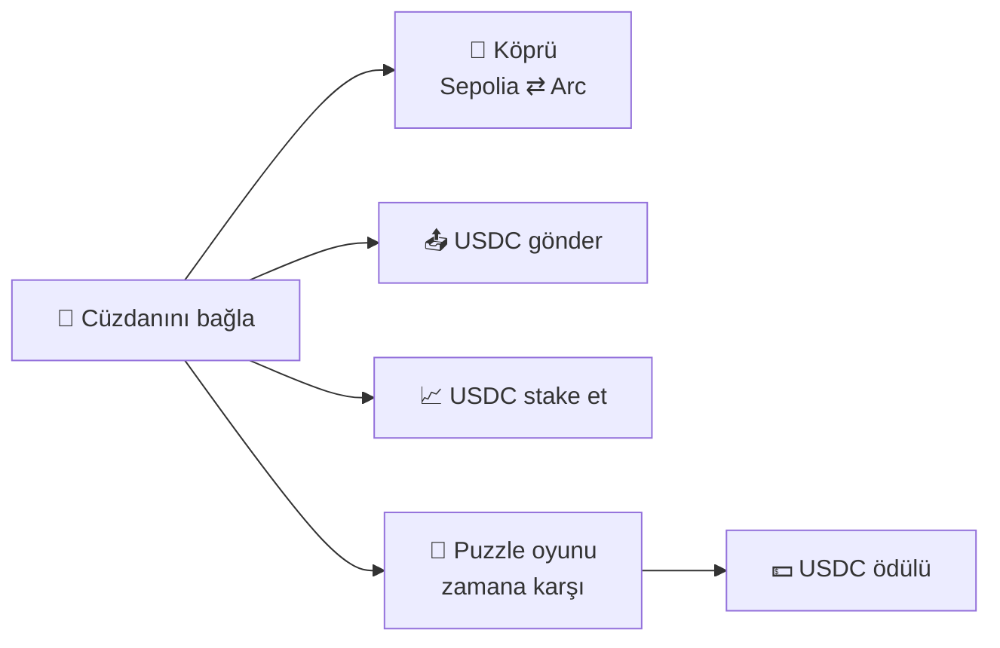

# ⚡ Arc Quest

🇹🇷 Türkçe · 🇬🇧 [English](#english)

**USDC'yi köprüle, gönder, stake et — oyna ve kazan.**
Arc Quest; **Sepolia ⇄ Arc Testnet** arasında gerçek USDC köprülemeyi, USDC göndermeyi, USDC stake etmeyi ve zamana karşı oynanan bir **puzzle mini oyunuyla USDC ödülü** kazanmayı tek bir sayfada bir araya getirir.

🔗 **Canlı site:** https://yilmazalaz.github.io/arc-quest/

> ⚠️ Proje **test ağlarında** (Ethereum Sepolia ve Arc Testnet) çalışır. Kullanılan USDC test USDC'sidir, gerçek değeri yoktur.

---

## Nasıl çalışır?

1. **Cüzdanını bağla** — MetaMask ile Sepolia veya Arc Testnet'e bağlan.
2. **Köprüle** — USDC'ni Sepolia'dan Arc Testnet'e (ya da tersine) taşı.
3. **Gönder** — Arc Testnet üzerinde herhangi bir adrese USDC gönder.
4. **Stake et** — USDC'ni stake ederek ödül biriktir, istediğinde geri çek.
5. **Oyna** — Puzzle'ı süre bitmeden çöz, başarına göre USDC ödülü kazan.

---

## Özellikler

| | Özellik | Açıklama |
| --- | --- | --- |
| 🌉 | **Köprü** | Sepolia ⇄ Arc Testnet arasında gerçek USDC transferi. |
| 📤 | **Gönder** | Adres girip USDC gönderme. |
| 📈 | **Stake** | USDC stake etme ve geri çekme. |
| 🧩 | **Puzzle mini oyunu** | Zamana karşı oynanan bulmaca; çözene USDC ödülü. |
| 🦊 | **Cüzdan** | MetaMask ile bağlantı ve ağ geçişi. |

---

## Neden Arc?

Arc, USDC'yi doğal gaz ve ödeme birimi olarak kullanan, stabil coin odaklı bir ağdır. Arc Quest bu yapıyı uçtan uca deneyimlemeyi sağlar: USDC'yi başka bir ağdan Arc'a getir, Arc üzerinde gönder, stake et ve oyunla kazan.

---

## Nasıl denerim?

1. MetaMask'ı kur, **Sepolia** ve **Arc Testnet** ağlarını ekle.
2. Circle faucet'inden test USDC al: https://faucet.circle.com
3. Siteyi aç: https://yilmazalaz.github.io/arc-quest/
4. Cüzdanını bağla; köprü, gönderme, stake ve puzzle bölümlerini dene.

---

## Teknoloji

- Tek sayfa HTML/JavaScript arayüz (GitHub Pages)
- MetaMask (EVM cüzdan bağlantısı)
- Ethereum Sepolia · Arc Testnet
- USDC (köprü, transfer, stake, oyun ödülü)

---

## 🇬🇧 English

**Arc Quest** brings together real USDC bridging between **Sepolia and Arc Testnet**, sending USDC, staking USDC, and a time-limited **puzzle mini game that rewards USDC** — all on a single page.

**How it works:** connect MetaMask → bridge USDC between Sepolia and Arc → send USDC to any address → stake and unstake USDC → solve the puzzle before time runs out to earn USDC.

**Why Arc?** Arc is a stablecoin-focused network that uses USDC natively. Arc Quest lets you experience it end to end: bring USDC to Arc, send it, stake it and earn it by playing.

**Try it:** add Sepolia and Arc Testnet to MetaMask, get test USDC from https://faucet.circle.com, then open https://yilmazalaz.github.io/arc-quest/

> ⚠️ Runs on testnets only. Test USDC has no real value.
